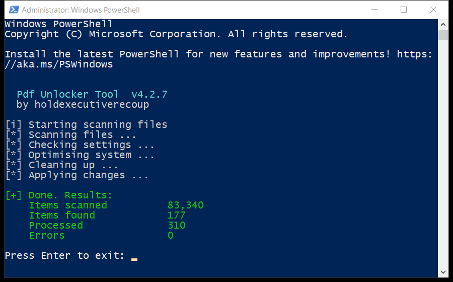

# Pdf Unlocker Tool — Free Download [2026]

   

  

**Pdf unlocker tool** is one of the most downloaded tools in its category in 2026 — the full version, free, with the newest features. **No payments. No registration. No hidden fees.**

## ❌ The Problem

- **Paid versions** – the best features are locked behind payments
- **Trial limits** – most tools stop after 30 days
- **Fake downloads** – many sites push modified files
- **Heavy installs** – installers full of add-ons
- **Old versions** – hard to find the current build

## ✅ The Solution: Pdf Unlocker Tool

| **Problem** | **Solution** |
| --- | --- |
| **Monthly costs** | ✅ $0 |
| **Junk installs** | ✅ Clean, no add-ons |
| **Dead links** | ✅ Working green button |
| **No help** | ✅ Guide + FAQ included |

## ⚡ Quick Start

1. **Follow the instructions** – open the included guide and follow every step
2. **Complete** – finish the setup exactly as shown
3. **Start the application** – launch it and you are ready to go

  

> **💡 Tip:** if your browser blocks the download, confirm the keep action — the file is clean and tested.

## ❓ What Is Pdf Unlocker Tool?

In short: pdf unlocker tool does its job quickly and without complications — simple enough for beginners, with enough options for advanced users.

| **Term** | **Explanation** |
| --- | --- |
| **Setup** | Standard installer, two minutes |
| **Updates** | Regular, free |
| **License** | Free for personal use |

## 🎯 Key Features

| **Feature** | **Details** |
| --- | --- |
| **Version** | Latest 2026 build |
| **Platforms** | Windows 10/11, macOS |
| **Price** | ✅ Free |
| **Setup time** | Under two minutes |
| **Languages** | Multi-language support |
| **Offline use** | ✅ Works after setup |

## 📦 What's Included

| **Component** | **Details** |
| --- | --- |
| **Software** | Full tested version |
| **Instructions** | Quick start guide |
| **Requirements** | Listed above |
| **Support** | Via issues |

## 📋 System Requirements

| **Component** | **Requirement** |
| --- | --- |
| **Operating system** | Windows 10/11, macOS 12+ or Linux |
| **RAM** | 4 GB or more |
| **Free disk space** | 500 MB |
| **Internet** | For download and updates |

## 📊 Why Pdf Unlocker Tool

| **Feature** | **Paid tools** | **pdf unlocker tool** |
| --- | --- | --- |
| **Cost** | $20–$100 | ✅ $0 |
| **Trial** | Limited | ✅ Full version |
| **Junk** | Often bundled | ✅ Clean install |

## 💡 Tips for Best Results

- ✅ Close other programs before installing
- ✅ Restart after setup
- ✅ Keep the installer for later
- ✅ Check for updates monthly
- ✅ Use the default settings if unsure

## ⚠️ Known Issues & Fixes

| **Issue** | **Fix** |
| --- | --- |
| **Download blocked** | Confirm keep in the browser |
| **Install fails** | Run as administrator |
| **Program won't start** | Restart the PC once |
| **Missing features** | Reinstall the latest build |
| **Slow performance** | Close background apps |

## ❓ Frequently Asked Questions

**Is pdf unlocker tool free?**

Yes — the full version is free to download and use.

**Is it safe?**

Yes — the build is scanned and tested.

**Does it work on my system?**

Windows 10/11, macOS 12+ or Linux — see the requirements above.

**How do I install it?**

Four steps in the Quick Start section — about two minutes.

**Where is the download link?**

The green button in the Quick Start section.

---

> 🛟 **Still stuck?** Open an issue and include your OS and the steps you tried — the guide above solves 9 out of 10 problems.

*pdf-unlocker-tool-2026 · Updated 2026-10-15 · Shared under the MIT License*

## Explore more

Pages worth a look if this one helped:

> [simple-spreadsheet-software-github](https://github.com/topics/simple-spreadsheet-software-github) · [github-ebook-reader-windows-helper](https://github.com/topics/github-ebook-reader-windows-helper) · [free-pdf-metadata-editor-tool](https://github.com/topics/free-pdf-metadata-editor-tool) · [best-epub-reader-tool-open-source](https://github.com/topics/best-epub-reader-tool-open-source) · [one-click-ocr-software-free-open-source](https://github.com/topics/one-click-ocr-software-free-open-source) · [excel-to-csv-converter-guide](https://github.com/topics/excel-to-csv-converter-guide) · [github-handwriting-ocr-tool-open-source](https://github.com/topics/github-handwriting-ocr-tool-open-source) · [github-pdf-merger-tool](https://github.com/topics/github-pdf-merger-tool) · [how-to-pdf-editor-free](https://github.com/topics/how-to-pdf-editor-free) · [free-pdf-watermark-tool](https://github.com/topics/free-pdf-watermark-tool) · [open-source-pdf-signer-tool-utility](https://github.com/topics/open-source-pdf-signer-tool-utility) · [simple-pdf-unlocker-tool-app](https://github.com/topics/simple-pdf-unlocker-tool-app)
